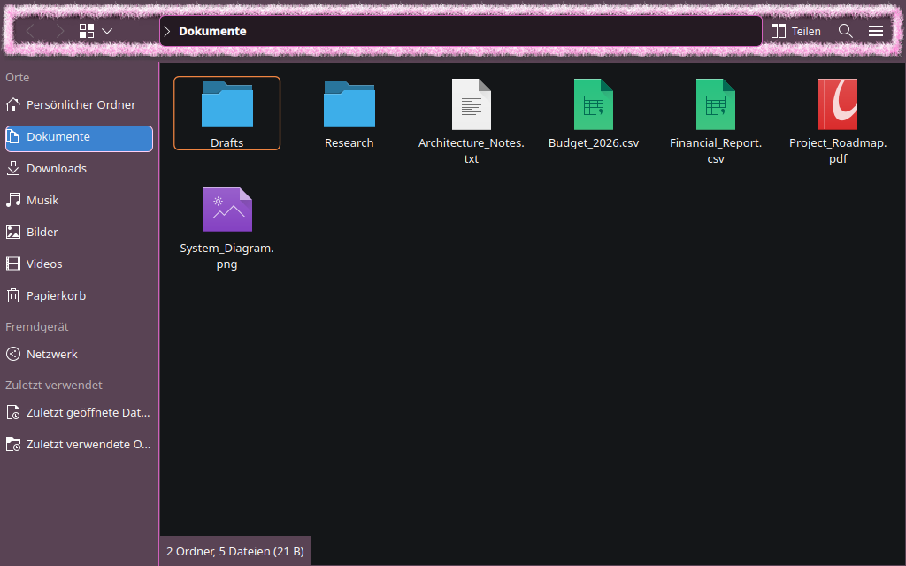
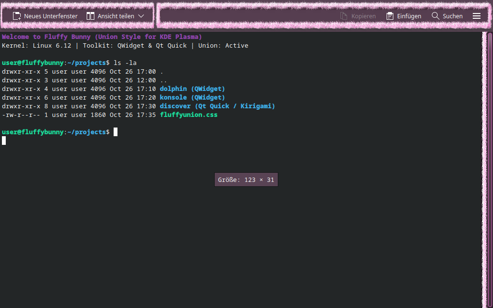
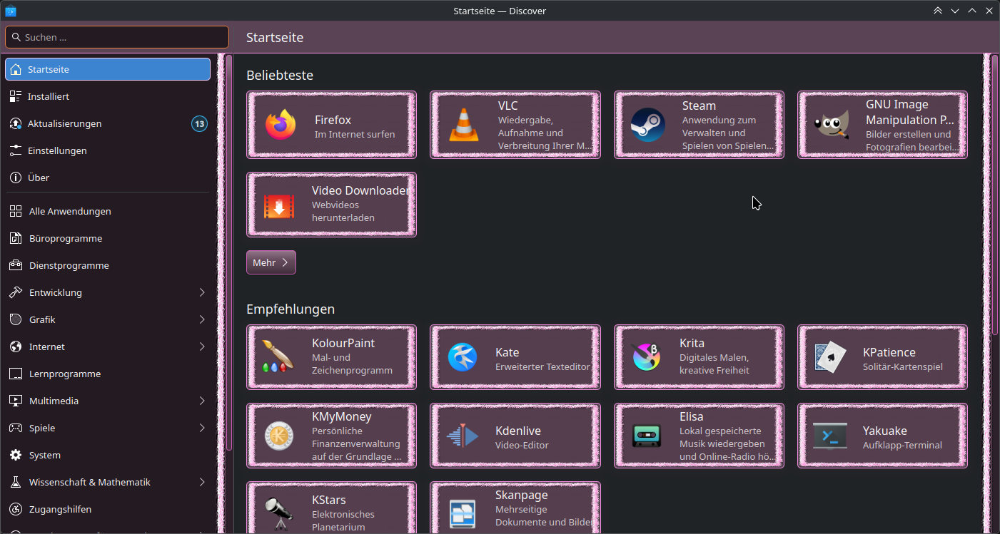
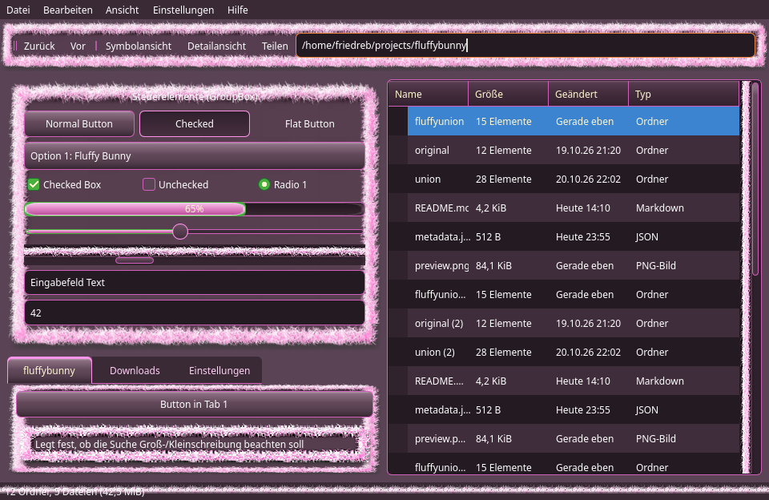
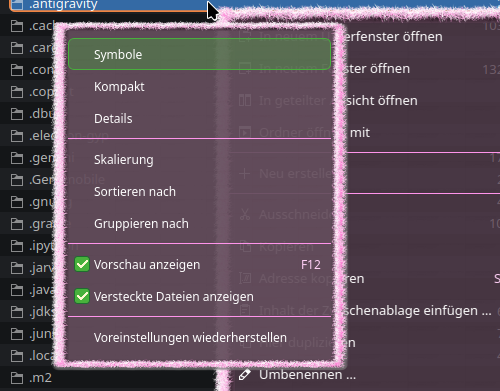

# Fluffy Bunny (Union)

> *"It's so fluffy it's making my teeth hurt."*

A modern recreation of the iconic KDE Plasma **Fluffy Bunny** theme as a [Union](https://invent.kde.org/plasma/union) CSS style for Qt and KDE applications.

---

## Screenshots

### Real Applications Showcase

#### Dolphin (**QWidget**)
Classic file manager styled with fluffy pink fur header and high-contrast dark view:


#### Konsole (**QWidget**)
Terminal emulator featuring the pink fur topbar and custom styled scrollbars:


#### Discover (**Qt Quick / Kirigami**)
KDE's software center built on Qt Quick and Kirigami, showing pink fur cards, scrollbars, and application catalogue:


### Controls & Menus Showcase

#### Widget Gallery
Overview of buttons, tabs, sliders, progress bars, checkboxes, and radio buttons:


#### Context Menu
Translucent 92% center with 4-sided pink fur frame:


---

## Features

- **Signature Pink Fur**: Native 1:1 fur borders for topbars, toolbars, popups, menus, dialogs, tooltips, and scrollbars.
- **Classic Palette**: High-contrast plum, cream, bright pink, and mint green accents.
- **Translucency & Blur**: 92% center opacity on menus and popups with background blur for depth while maintaining text legibility.
- **Both Toolkits Supported**: Uniform appearance across **QWidget** and **Qt Quick / Kirigami** applications.

---

## Installation

Link the theme directory into your Union styles folder:

```bash
mkdir -p ~/.local/share/union/styles
ln -s /home/friedreb/projects/fluffybunny/fluffyunion ~/.local/share/union/styles/fluffyunion
```

Then activate **Fluffy Bunny (Union)** under **System Settings → Colors & Themes → Application Style**.

---

## Roadmap

- **Plasma Theming**: Planned to also theme Plasma itself (panels, desktop widgets, system tray, notifications) as soon as Union supports it.

---

## Disclaimer

Everything in this project was created using AI (Gemini). As a backend engineer and DevOps guy, doing frontend every time kills me a little more inside—but Fluffy Bunny simply *had* to be resurrected, and I wanted to see if Union was already capable of pulling it off as a showcase.

---

## Authors & Credits

- **Union Style**: Bernhard Friedreich ([friesoft@gmail.com](mailto:friesoft@gmail.com))
- **Original Theme & Artwork**: fsshepper
- **Breeze Union Stylesheet Base**: Arjen Hiemstra, Akseli Lahtinen, Niccolò Venerandi
